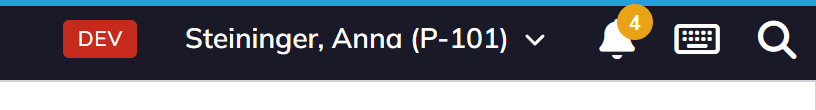
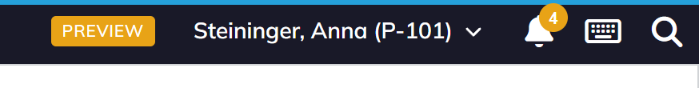
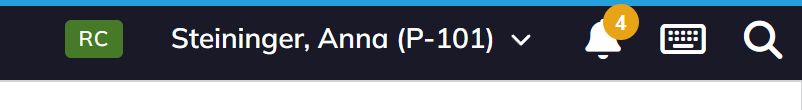
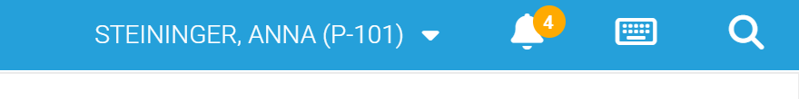
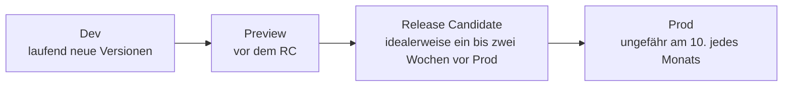

# Web-Client

Der Web-Client ist der Haupt-Client von time cockpit und der Client, mit dem wir neuen Benutzern den Einstieg empfehlen. Er läuft ohne Installation in jedem aktuellen Browser, auf Desktop-Rechnern und Laptops ebenso wie auf Tablets und Smartphones (siehe [Mobile Zeiterfassung](~/doc/erste-schritte/mobile-zeiterfassung.md)). Sie können ihn auch als App installieren (siehe [time cockpit als App installieren](#time-cockpit-als-app-installieren)).

## Einschränkungen

- Der Web-Client selbst zeichnet keine Signale Ihres Rechners auf. Dafür gibt es [time cockpit sidekick](~/doc/sidekick/ueberblick.md), eine eigene kleine Anwendung, die Ihre Aktivitäten aufzeichnet und im Zeiterfassungskalender des Web-Clients anzeigt; sidekick ist derzeit in der Preview. Signale, die der [klassische Signal Tracker](~/doc/signal-tracker/ueberblick.md) des Fullclients aufzeichnet, sehen Sie ebenfalls im Web-Client.
- Das Datenmodell lässt sich im Web-Client nicht ändern. Änderungen, die Sie mit dem Fullclient vornehmen, stehen aber auch im Web-Client zur Verfügung (siehe [Anpassung des Datenmodells](~/doc/datenmodell-anpassung/ueberblick.md)).

Bei Fragen zu sidekick, zum Signal Tracker oder zur Anpassung von time cockpit schreiben Sie uns an [support@timecockpit.com](mailto:support@timecockpit.com).

## time cockpit als App installieren

time cockpit ist eine Progressive Web App (PWA): Sie können den Web-Client wie eine Anwendung installieren. Er läuft dann in einem eigenen Fenster und lässt sich aus dem Startmenü oder der Taskleiste starten.

1. Öffnen Sie [time cockpit](https://web.timecockpit.com) in Google Chrome oder Microsoft Edge.
2. Klicken Sie rechts in der Adressleiste auf das Symbol zum Installieren und dann auf **Installieren**. Der Browser nennt die App **time cockpit**.

### Mehrere Tabs im App-Fenster

Ohne weitere Einstellung öffnet die installierte App jede Seite in einem eigenen Fenster. Chrome und Edge können stattdessen Tabs im App-Fenster anzeigen. Die Einstellung dafür ist eine experimentelle Funktion des Browsers; ob es sie gibt und wie sie heißt, kann sich mit jeder Browserversion ändern.

1. Öffnen Sie in Chrome `chrome://flags/`, in Edge `edge://flags/`.
2. Suchen Sie die Einstellung **Desktop PWA tab strips** und setzen Sie sie auf **Enabled**.
3. Starten Sie den Browser neu, wenn er Sie dazu auffordert.

## Release-Plan

Es gibt vier Umgebungen: Dev, Preview, Release Candidate (RC) und Prod. Preview, RC und Prod öffnen Sie alle unter derselben Adresse, <https://web.timecockpit.com>. Auf welche dieser Umgebungen ein ganzer Tenant oder einzelne Benutzer kommen, legen wir fest; die Adresse im Browser bleibt dieselbe.

In welcher Umgebung Sie arbeiten, zeigt ein Badge rechts oben in der Menüleiste des Web-Clients:

| Umgebung | Rechts oben im Web-Client |
|---|---|
| Dev |  |
| Preview |  |
| Release Candidate |  |
| Prod |  kein Badge |

Auf einem schmalen Bildschirm zeigt das Badge nur die ersten drei Buchstaben, zum Beispiel **PRE**.

Eine neue Version erscheint ungefähr am 10. jedes Monats in Prod. Die anderen Umgebungen bekommen sie jeweils etwas früher:

### Dev: <https://web-dev.timecockpit.com>

Dev ist eine experimentelle Version, die wir laufend mit neuen Versionen aktualisieren. Verwenden Sie Dev nicht für Ihre produktive Arbeit: Manches funktioniert dort wahrscheinlich nicht, und mit Ihrem produktiven Tenant kann Dev sogar Daten beschädigen. Wenn Sie Dev ausprobieren möchten, fragen Sie nach einer time cockpit-Sandbox.

### Preview

Preview bekommt eine neue Version vor dem Release Candidate. Sie ist deutlich stabiler als Dev, kann sich aber noch ändern. Nutzen Sie Preview, um Ihr Team auf eine neue Version vorzubereiten und uns Feedback zu geben.

### Release Candidate (RC)

Der Release Candidate ist die Version, die als Nächstes in Prod kommt. Idealerweise steht er ein bis zwei Wochen vor dem Prod-Release bereit. Im RC arbeiten deutlich mehr Benutzer als in Preview.

### Prod

Prod ist die stabile Produktivumgebung von time cockpit. Eine neue Version erscheint hier ungefähr am 10. jedes Monats, zusammen mit unserem Newsletter. Während des Monats aktualisieren wir Prod nur für kritische Fehlerbehebungen.
