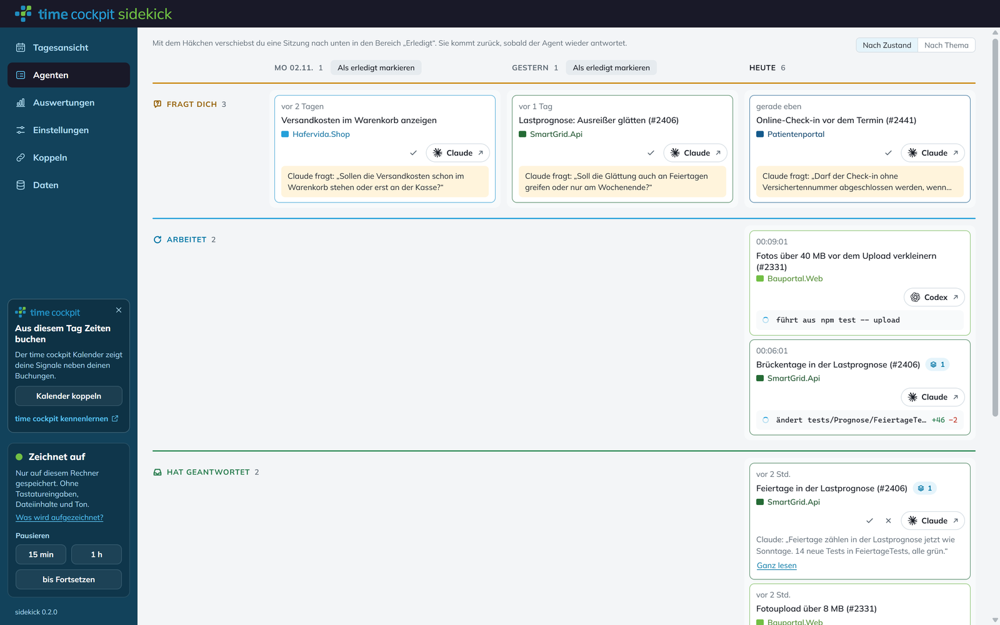
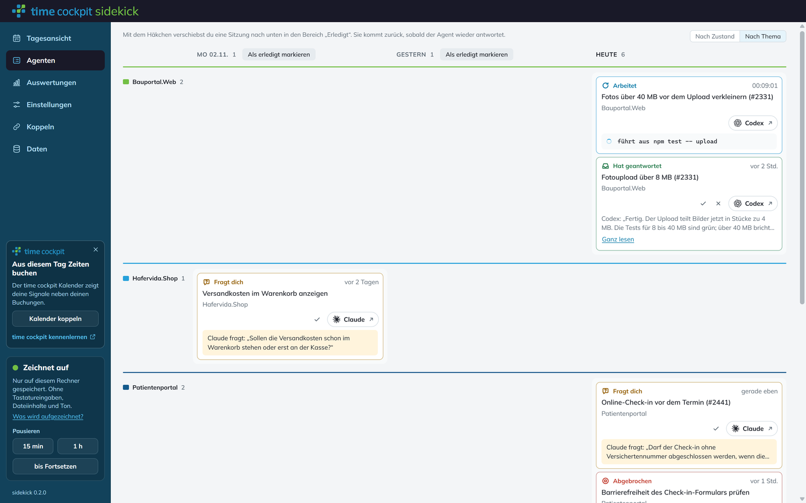

# Der Reiter Agenten in sidekick

> [!WARNING]
> Preview: time cockpit sidekick befindet sich in einer Vorschauphase. Funktionen, Bezeichnungen und Einrichtungsschritte können sich ohne Vorankündigung ändern. sidekick läuft unter Windows 10/11 und macOS. Während der Preview funktioniert sidekick nur mit `https://web-preview.timecockpit.com`. Feedback: [support@timecockpit.com](mailto:support@timecockpit.com)

Wenn Sie mit mehreren Claude-Code- oder Codex-Sessions gleichzeitig arbeiten, wartet oft eine davon auf Sie: Sie stellt eine Frage, sie ist fertig, oder sie ist mittendrin stehen geblieben. Der Reiter **Agenten** in sidekick zeigt die Sessions auf Ihrem Rechner danach, wer am Zug ist. So sehen Sie auf einen Blick, welche Session Sie braucht und welche noch arbeiten.

Der Reiter liegt zwischen **Tagesansicht** und **Auswertungen**. Er liest die Sessions live aus den Dateien von Claude Code und Codex und speichert nichts davon (siehe [Datenschutz](#datenschutz)).

## Sie sind dran, Tag für Tag

Der obere Teil des Reiters zeigt die Sessions, bei denen Sie am Zug sind. Jeder Tag mit einer solchen Session hat eine Spalte, heute steht rechts. Ein Tag ohne wartende Session hat keine Spalte. Passen nicht alle Tage nebeneinander, sammelt die Spalte **Älter** links die ältesten.

Der Kopf einer Spalte nennt den Tag (**Heute**, **Gestern** oder den Wochentag mit Datum) und zählt seine Sessions. Jede Session ist eine Karte mit ihrer Zeit, ihrem Titel, ihrem Projekt und ihren Schaltflächen. Eine Frage steht in einem gelben Kasten, eine laufende Session zeigt ihre letzten Werkzeugaufrufe und eine fertige den Anfang ihrer Antwort mit **Ganz lesen**.

Wartet nichts auf Sie, sagt der Bereich **Alles erledigt.** oder, solange noch Sessions laufen, **Gerade braucht dich keine Sitzung, die Agenten arbeiten.**

## Zustände

Mit **Nach Zustand** ist jeder Zustand, der eine Session hat, eine eigene Zeile mit seinem Namen, seiner Anzahl und einer farbigen Linie über die ganze Breite:

| Zustand | Bedeutung |
|---|---|
| **Fragt dich** | Der Agent stellt Ihnen eine Frage und wartet auf Ihre Antwort. Bei Claude Code gehört dazu auch ein Plan, der auf Ihre Freigabe wartet, und in der Claude-Desktop-App ein fertiger Durchlauf, der mit einer Frage endet. Eine Frage, die Sie beiseitegelegt haben, zeigt sich als **Frage offen**. |
| **Arbeitet** | Der Agent arbeitet an einem Durchlauf, in der Spalte von heute. Die Karte zeigt, wie lange der Durchlauf schon läuft, und seine letzten Werkzeugaufrufe. Eine Karte mit **Wartet** gehört zu einem Durchlauf, der beendet ist, dessen Agent aber auf eine selbst gestartete Aufgabe im Hintergrund wartet und dann von selbst weitermacht (nur Claude Code). |
| **Hat geantwortet** | Der Agent ist fertig, und Sie haben seine Antwort noch nicht als erledigt markiert. |
| **Abgebrochen** | Der Durchlauf wurde gestoppt, bevor der Agent fertig war, zum Beispiel weil Sie ihn angehalten oder einen Werkzeugaufruf abgelehnt haben. |
| **Unterbrochen** | Claude Code wurde mitten im Durchlauf beendet. Es geht erst weiter, wenn Sie die Session öffnen und den Agenten weitermachen lassen. **Unbeantwortet** heißt, dass die App beendet wurde, bevor der Agent mit Ihrer letzten Nachricht begonnen hat; schicken Sie sie noch einmal. |
| **Verstummt** | Der Durchlauf hat kein Ende, und seit mindestens fünf Minuten gab es keine Aktivität (eine Stunde, solange ein Werkzeugaufruf läuft). Ob er noch läuft, ist unklar. |

Der Hinweis eines Zustandsworts erklärt es, wo das Wort allein nicht genug sagt.

## Nach Zustand oder nach Thema

Der Umschalter **Nach Zustand | Nach Thema** rechts oben bestimmt, was die Zeilen des oberen Bereichs sind. sidekick merkt sich Ihre Wahl.

- **Nach Zustand**: eine Zeile je Zustand, wie oben beschrieben.
- **Nach Thema**: eine Zeile je Thema, alphabetisch geordnet, jede mit einer Linie in der Farbe des Themas. Die Karten zeigen dann wieder ihren Zustand, mit Wort und Farbe.

Das Thema einer Session ist der Arbeitsbereich, zu dem ihr Ordner gehört, oder der Name des Ordners, in der Farbe, in der die **Tagesansicht** ihn am Tag der letzten Aktivität der Session zeichnet. Der Rahmen einer Karte und ihr Projekt haben dieselbe Farbe.

## Sessions als erledigt markieren

Eine Session bleibt im oberen Bereich, bis Sie sagen, dass Sie mit ihr fertig sind. Ihre Details anzusehen oder sie in Claude oder Codex zu öffnen, ändert daran nichts.

- Das Häkchen (**Als erledigt markieren**) verschiebt eine Session nach unten zu **Erledigt**. Sie kommt zurück, sobald der Agent wieder antwortet, auch wenn ihr nächster Durchlauf abgebrochen wird. Das sagt auch die Zeile über den Tagen.
- Bei einer Frage heißt das Häkchen **Frage beiseitelegen**. Die Session ruht dann als **Frage offen**, bis sich in ihr etwas Neues tut.
- Unter **Erledigt** holt der Pfeil (**Als nicht erledigt markieren**) eine Session zurück nach oben zu ihrem Tag.
- Der Kopf jedes Tages außer heute hat **Alle n als erledigt markieren** (bei einem Tag mit nur einer Session **Als erledigt markieren**). Damit markieren Sie alle Sessions dieses Tages auf einmal. Danach bietet eine Zeile über den Tagen 15 Sekunden lang **Rückgängig** an. Sessions von heute markieren Sie einzeln.
- Das Kreuz (**Ausblenden**) gibt es bei Sessions, deren Durchlauf beendet ist. Es legt die Session unter **Ausgeblendet** ab, bis Sie **Wiederherstellen** wählen. Solange die Session läuft oder fragt, steht sie oben; ihre nächste Antwort landet wieder unter **Ausgeblendet**.

Unter den Tagen sammelt der Bereich **Erledigt** alle ruhenden Sessions, in den Gruppen **Heute**, **Diese Woche**, **Älter** und **Ausgeblendet**. Ein Klick auf **Erledigt** klappt ihn auf oder zu.

### Ihr erster Besuch

Beim ersten Besuch zählen nur Sessions als Ihre, deren Durchlauf in den letzten 24 Stunden geendet hat. Ältere Enden ruhen von Anfang an unter **Erledigt**, damit der Reiter nicht mit jeder Session beginnt, die Sie je hatten.

## Details und eine Session öffnen

Ein Klick auf den Titel einer Karte öffnet ihre Details in einem Bereich rechts:

- die Schaltflächen, um die Session zu öffnen und als erledigt zu markieren,
- was die Session gerade tut, solange etwas läuft (**Jetzt**),
- das letzte Ergebnis in voller Länge (**Letztes Ergebnis**),
- die Aufgaben, die sie im Hintergrund ausführt (**Im Hintergrund**),
- den **Verlauf** mit ihren letzten Ereignissen,
- das Modell und den Ordner.

Ziehen Sie den linken Rand des Bereichs, um ihn breiter oder schmaler zu machen. Das Kreuz rechts oben im Bereich oder **Esc** schließt ihn.

Um eine Session fortzusetzen, verwenden Sie die Schaltfläche mit dem Namen des Agenten auf ihrer Karte (**Claude** oder **Codex** mit einem Pfeil), **In Claude öffnen** oder **In Codex öffnen** in den Details, oder klicken Sie auf den gelben Kasten einer Frage. sidekick übergibt die Session an die Claude-Desktop-App oder an Codex, wo Sie antworten.

### Aufgaben im Hintergrund

Bei Claude Code zeigt eine kleine Markierung neben dem Titel, wie viele Befehle oder Subagenten die Session im Hintergrund gestartet hat, die sich noch nicht zurückgemeldet haben. Die Details nennen jede mit ihrer Beschreibung, ihrer Art (**Befehl** oder **Subagent**) und wann sie begann. Die Markierung ist ein Hinweis, kein Zustand: Ein Server, der im Hintergrund weiterläuft, hält eine Session nicht in **Arbeitet**. Ist eine Session seit mehr als 12 Stunden still, erscheinen ihre Hintergrundaufgaben als **unklar**, weil sie spurlos enden, wenn Claude Code beendet wird.

## Welche Sessions erscheinen

- Claude-Code- und Codex-Sessions auf diesem Rechner, die sich in den letzten 30 Tagen geändert haben.
- Keine archivierten Sessions und nicht die Subagent-Threads von Codex.
- Nicht die Sessions eines Agenten, den Sie in sidekick unter **Einstellungen** ausgeschaltet haben.

Wenn Sie den Reiter nach dem Start von sidekick zum ersten Mal öffnen, kann das Lesen aller Sessions einen Moment dauern. Die neuesten erscheinen zuerst, und eine Zeile über der Liste sagt, wie viele Sessions noch gelesen werden.

Kann die Datei einer Session kurz nicht gelesen werden, zum Beispiel weil ein Virenscanner sie sperrt, ist die Karte ausgegraut und zeigt den letzten bekannten Stand.

## Grenzen

- Nur Claude Code und Codex. GitHub Copilot und andere Agenten erscheinen nicht.
- Nur Sessions auf diesem Rechner. Sessions auf [Remote-Rechnern](~/doc/sidekick/ueberblick.md#was-sidekick-aufzeichnet), die sidekick über SSH liest, stehen nicht im Reiter.
- Eine Claude-Code-Session lässt sich nur dann aus sidekick öffnen, wenn die Claude-Desktop-App sie kennt. Eine Session, die in einem Terminal gestartet wurde, zeigt den Namen des Agenten ohne Pfeil; setzen Sie sie in diesem Terminal fort.
- Fragt Claude Code um Erlaubnis, ein Werkzeug auszuführen, kann der Reiter das aus den Session-Dateien nicht erkennen. Die Session steht dann unter **Arbeitet**, als liefe der Werkzeugaufruf.
- Hintergrundaufgaben und **Wartet** gibt es nur für Claude Code.

## Datenschutz

Der Reiter liest die Sessions live, solange er angezeigt wird. Nichts davon wird in der Datenbank von sidekick gespeichert, im Zeiterfassungskalender angezeigt oder irgendwohin gesendet. sidekick merkt sich auf diesem Rechner nur, welche Sessions Sie als erledigt markiert oder ausgeblendet haben und wie Sie den Reiter eingerichtet haben.

Der Reiter zeigt mehr von einer Session als die Tagesansicht: die letzte Nachricht des Agenten, seine Fragen und den Anfang der Befehle, die er ausführt. Siehe [Datenschutz und Daten in sidekick](~/doc/sidekick/datenschutz-und-daten.md#der-reiter-agenten).

## Verwandte Seiten

- [time cockpit sidekick](~/doc/sidekick/ueberblick.md)
- [sidekick-Signale im Zeiterfassungskalender](~/doc/sidekick/signale-im-kalender.md)
- [Datenschutz und Daten in sidekick](~/doc/sidekick/datenschutz-und-daten.md)
