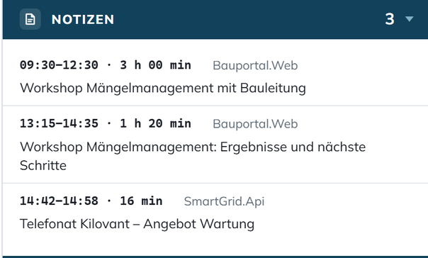

# Notizen mit sidekick

> [!WARNING]
> Preview: time cockpit sidekick befindet sich in einer Vorschauphase. Funktionen, Bezeichnungen und Einrichtungsschritte können sich ohne Vorankündigung ändern. sidekick läuft unter Windows 10/11 und macOS. Während der Preview funktioniert sidekick nur mit `https://web-preview.timecockpit.com`. Feedback: [support@timecockpit.com](mailto:support@timecockpit.com)

Signale zeigen, wann Sie gearbeitet haben und mit welchen Anwendungen, aber nicht immer, woran. Ein Telefonat, ein Gespräch am Schreibtisch oder eine schnelle Korrektur hinterlassen kaum Spuren. Mit einer Notiz halten Sie es in wenigen Worten fest, ohne die Anwendung zu verlassen, in der Sie gerade sind. sidekick behält die Notiz mit ihrer Zeit, und der [Zeiterfassungskalender](~/doc/zeiterfassungskalender/kalender.md) zeigt sie neben den Signalen, sodass Sie sie später mit ihrem Text buchen können.

Eine Notiz kann zweierlei:

- **Wie eine Stoppuhr**: Schreiben Sie eine Notiz, wenn Sie beginnen, zum Beispiel „Workshop vorbereiten“. Sie läuft, bis Sie sie beenden oder die nächste Notiz schreiben.
- **Im Nachhinein**: Schreiben Sie eine Notiz, wenn Sie fertig sind, zum Beispiel nach einem Telefonat, und setzen Sie ihren Beginn, zum Beispiel 30 Minuten zurück.

## Das Notizfenster öffnen

- Drücken Sie die Tastenkombination für eine neue Notiz: **Strg+Alt+N** unter Windows, **⌘⌥N** unter macOS. Sie können die Kombination in den Einstellungen ändern oder abschalten (siehe [Tastenkombination](#tastenkombination)).
- Oder wählen Sie **Notiz…** im Menü des Symbols im Infobereich.

Das Fenster **Notiz** öffnet sich über jeder Anwendung, auf dem Bildschirm mit dem Mauszeiger, und der Cursor steht im Textfeld. Tippen Sie, woran Sie arbeiten, und drücken Sie **Enter**.

## Das Notizfenster

| Feld | Was es bewirkt |
|---|---|
| Textfeld | Woran Sie arbeiten, in wenigen Worten. **Umschalt+Enter** beginnt eine neue Zeile. |
| **Uhrzeit** | Wann die Notiz beginnt oder endet. Sie beginnt mit der aktuellen Uhrzeit (Hinweis **jetzt**) und lässt sich ändern. |
| **Ohne Dauer** | Die Notiz bleibt ein Zeitpunkt: Sie läuft nicht, lässt sich nicht beenden und wird im Kalender kein Vorschlag. Das Häkchen blendet den Beginn aus. |
| **Beginn** | Optional. Mit einem Beginn deckt die Notiz die Zeit vom Beginn bis zur **Uhrzeit** ab; siehe unten. |
| **Arbeitsbereich** | Zu welchem der heutigen Arbeitsbereiche oder Termine die Notiz gehört. |

Über den Schaltflächen sagt ein Satz, was **Enter** mit dem tut, was gerade in den Feldern steht, zum Beispiel „Startet um 11:00 und läuft, bis du sie beendest oder die nächste Notiz schreibst.“ oder „Gilt von 10:30 bis 11:00 (30 min) und läuft nicht weiter.“

**Enter** oder **Speichern** speichert die Notiz, und sidekick bestätigt sie mit einer stillen Benachrichtigung **Notiz gespeichert**. **Esc** verwirft die Notiz. Schließen Sie das Fenster mit seiner Schließen-Schaltfläche oder klicken Sie in ein anderes Fenster, bleibt der Text für das nächste Öffnen erhalten. Ein offen gelassenes Fenster rückt hinter die anderen Fenster und hat eine eigene Schaltfläche in der Taskleiste; die Tastenkombination holt es wieder nach vorn.

### Eine laufende Notiz

Ohne Beginn startet die Notiz zur **Uhrzeit** und läuft wie eine Stoppuhr, bis Sie sie beenden oder die nächste Notiz schreiben. Die neueste Notiz von heute, die sich noch beenden lässt, ist die laufende Notiz.

Solange eine Notiz läuft, zeigt das Notizfenster sie oben, zum Beispiel „Läuft seit 16:45 · 1 h 16 min“ mit ihrem Text:

- **Zum Beenden** öffnen Sie das Notizfenster, lassen den Text leer und drücken **Enter**. Die Schaltfläche lautet **Beenden um 18:01**; sidekick bestätigt mit **Notiz beendet**. **Esc** schließt das Fenster, und die Notiz läuft weiter.
- **Zum Wechseln** tippen Sie die neue Notiz. **Laufende Notiz um 18:01 beenden** ist angehakt: Das Speichern beendet die laufende Notiz zur **Uhrzeit**, und die neue Notiz startet dort und läuft. Entfernen Sie das Häkchen, bleibt die laufende Notiz offen; der Beginn steht dann wieder zur Verfügung.

Ältere Notizen, die noch offen sind, beenden Sie in der Tagesansicht von sidekick (siehe [Notizen bearbeiten, beenden und löschen](#notizen-bearbeiten-beenden-und-löschen)).

### Eine Notiz mit Beginn

Mit einem Beginn deckt die Notiz die Zeit vom Beginn bis zur **Uhrzeit** ab und läuft nicht weiter. Die Chips neben dem Beginn setzen ihn mit einem Klick:

- „seit 10:12 · zurück am Platz“: das Ende Ihrer letzten Pause von mindestens 15 Minuten heute, mit seiner Uhrzeit.
- **−15 min**, **−30 min** und **−1 h**: so lange vor der **Uhrzeit**.

Wenn Sie zum Beispiel nach einem Anruf auflegen, öffnen Sie das Notizfenster, tippen „Telefonat mit dem Kunden zum Angebot“ und wählen **−30 min**.

### Arbeitsbereich

**Arbeitsbereich** zeigt die heutigen Arbeitsbereiche und Termine als Chips, in denselben Farben wie in der Tagesansicht von sidekick. Der Bereich, der in der letzten Viertelstunde im Vordergrund war, ist vorausgewählt. Wählen Sie einen anderen Chip oder **Keiner** für eine Notiz ohne Arbeitsbereich. Der Kalender zeichnet die Notiz in der Farbe ihres Arbeitsbereichs.

## Notizen bearbeiten, beenden und löschen

Notizen werden nur in sidekick bearbeitet, beendet und gelöscht. Öffnen Sie den Reiter **Tagesansicht**:

- An einem Tag mit Notizen zeigt die Spur **Notizen** rechts von **Aktiv** für jede Notiz ein Blattsymbol zu ihrer Zeit, in der Farbe ihres Arbeitsbereichs. Eine Notiz mit Ende hat einen dünnen Balken bis zu ihrem Ende. Der Tooltip zeigt den Text.
- Der rechte Bereich beginnt mit dem Abschnitt **Notizen**: den Notizen des Tages oder des ausgewählten Bereichs. Die Suche des Bereichs findet auch Notizen.
- Die Zeile der laufenden Notiz sagt zum Beispiel „läuft seit 1 h 15 min“ und hat die Schaltfläche **Beenden um 18:01**, die die Notiz jetzt beendet. Der Pfeil daneben öffnet **Ende um** für eine andere Uhrzeit des Tages der Notiz und **Ohne Dauer lassen**. Jede andere offene Notiz hat **Beenden** unter den Schaltflächen ihrer Zeile.
- **Bearbeiten** öffnet in der Zeile ein kleines Formular mit dem Text, **Beginn**, **Ende (optional)**, **Ohne Dauer** und **Arbeitsbereich**. **Strg+Enter** oder **Speichern** speichert die Änderungen, **Esc** oder **Abbrechen** verwirft sie.
- **Löschen** fragt in der Zeile **Notiz löschen?**. Bestätigen Sie mit **Löschen**, oder behalten Sie die Notiz mit **Abbrechen**.

## Tastenkombination

Öffnen Sie in sidekick **Einstellungen** und in der Gruppe **Für alle Rechner** den Bereich **Notizen**.

- Klicken Sie in das Feld **Tastenkombination für eine neue Notiz** und drücken Sie die gewünschten Tasten. Eine Kombination braucht **Strg** (**⌘** unter macOS), **Alt** oder **Win** und genau eine weitere Taste.
- **Aus** schaltet die Tastenkombination ab. **Standard** stellt **Strg+Alt+N** (**⌘⌥N** unter macOS) wieder her.
- Die Änderung gilt, sobald Sie die Einstellungen speichern.

Solange sidekick läuft, bekommt keine andere Anwendung diese Tastenkombination. Verwendet eine andere Anwendung sie bereits, sagt der Bereich das; wählen Sie dann eine andere Kombination. **Notiz…** im Menü des Symbols im Infobereich funktioniert in jedem Fall weiter.

## Notizen im Zeiterfassungskalender

Der Kalender liest Ihre Notizen zusammen mit den Signalen von sidekick:

- Jede Ansicht zeigt jede Notiz zu ihrer Zeit, in der Farbe ihres Arbeitsbereichs. Eine laufende Notiz wächst bis zur aktuellen Zeit.
- Ein Doppelklick auf eine Notiz oder **Buchen** in ihrem Tooltip öffnet eine neue Zeitbuchung mit dem Text und der Zeit der Notiz. Siehe [Notizen](~/doc/sidekick/signale-im-kalender.md#notizen).
- In der Tagesansicht zeigt die Spur **Vorschlag** jede Notiz mit Dauer als eigenen Block, die laufende Notiz bis jetzt. In ihrem Zeitraum hat die Notiz Vorrang vor den anderen Signalen. Notizen ohne Dauer werden kein Vorschlag.

Der Kalender ändert oder löscht nie eine Notiz.

## Datenschutz und Löschen

Notizen bleiben auf Ihrem Rechner, in derselben Datenbank wie die Signale, und sind in den täglichen Sicherungen enthalten. sidekick lädt sie nie hoch, und der Kalender liest sie genauso wie die Signale: nur aus dem Browser auf demselben Rechner und nur für gekoppelte Kalender.

Anders als Signale werden Notizen nach Ablauf der Aufbewahrungsdauer nicht gelöscht; sie bleiben, bis Sie sie löschen. **Daten löschen** im Reiter **Daten** behält Ihre Notizen, außer Sie wählen **Notizen mitlöschen**. Siehe [Datenschutz und Daten in sidekick](~/doc/sidekick/datenschutz-und-daten.md#daten-löschen).

## Verwandte Seiten

- [time cockpit sidekick](~/doc/sidekick/ueberblick.md)
- [sidekick-Signale im Zeiterfassungskalender](~/doc/sidekick/signale-im-kalender.md)
- [Datenschutz und Daten in sidekick](~/doc/sidekick/datenschutz-und-daten.md)
