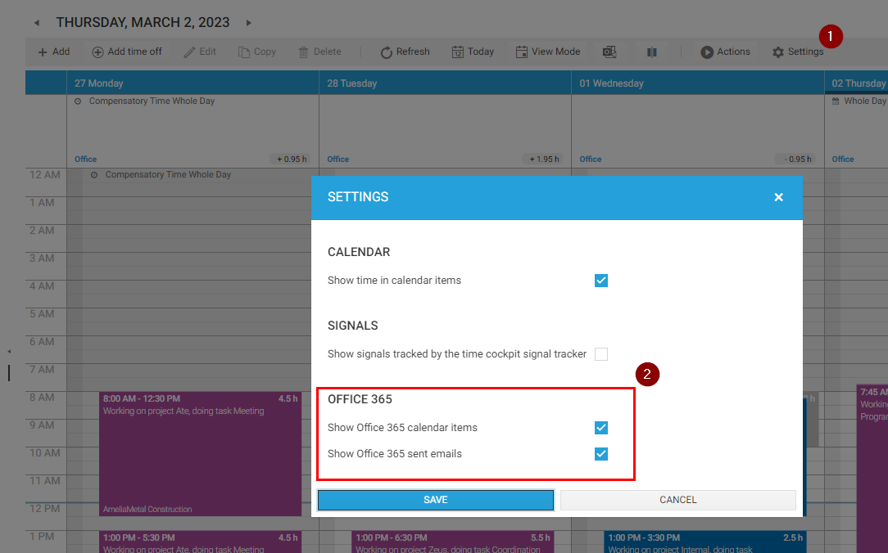
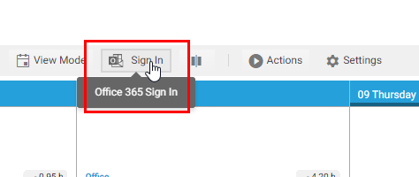
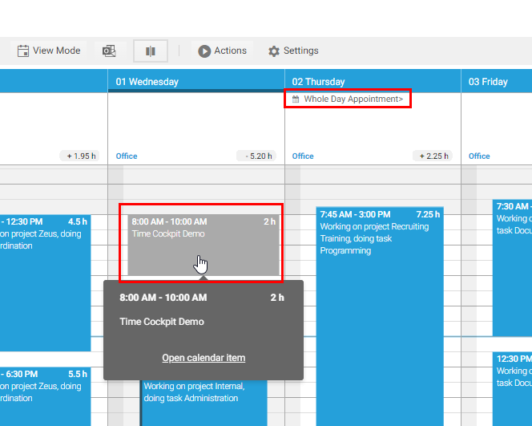
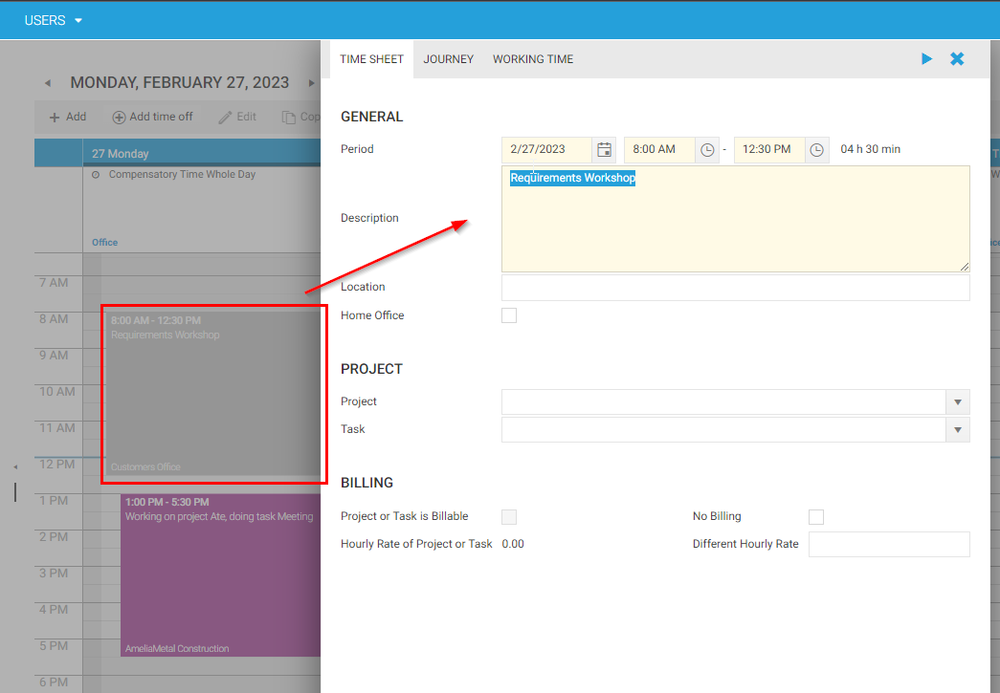
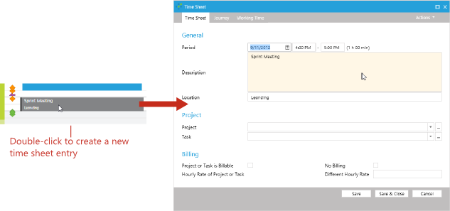

# Arbeiten mit Outlook-Terminen

time cockpit lässt sich mit Ihrem Office 365-Konto verbinden. Sobald die Verbindung eingerichtet ist, zeigt time cockpit Ihre Outlook-Termine und gesendeten E-Mails direkt im Zeiterfassungskalender an. Das ist beim Buchen Ihrer Zeiten besonders nützlich, weil Sie so gut sehen, womit Sie Ihren Arbeitstag verbracht haben. Auch gesendete E-Mails geben einen guten Hinweis auf Ihre Tätigkeiten im Lauf des Tages.

Wenn Sie time cockpit mit Ihrem Office 365-Konto verbinden, erhalten Sie ein umfassenderes Bild Ihres Arbeitstags und können Ihre Zeit einfach erfassen und verwalten.

## Office 365-Verbindung einrichten

* Klicken Sie im Zeiterfassungskalender auf **Einstellungen** und aktivieren Sie **Office 365 Kalendereinträge anzeigen** und **Office 365 gesendete E-Mails anzeigen**.

* Klicken Sie in der Symbolleiste von time cockpit auf **Sign In** und geben Sie Ihre Office 365-Anmeldedaten ein.

> [!NOTE]
> Die Anmeldung kann sich im Hintergrund öffnen. Prüfen Sie Ihre Fenster daher mit Alt + Tab, wenn Sie die Office 365-Anmeldung nicht sofort sehen.

* Klicken Sie in der Symbolleiste von time cockpit auf **Aktualisieren**, um Outlook-Termine und E-Mails aus Office 365 abzurufen.

> [!NOTE]
> Um einen Outlook-Termin in eine Zeitbuchung umzuwandeln, doppelklicken Sie einfach darauf und ergänzen Sie die fehlenden Daten.

## So erscheinen Termine im Kalender

Zeitbuchungen sind mit einer Farbe gefüllt. Outlook-Termine haben nur eine Kontur, sodass Sie auf einen Blick sehen, was gebucht ist und was nicht.

Standardmäßig liegen Zeitbuchungen über den Terminen derselben Zeit, und ein Termin bleibt sichtbar:

* Liegt eine Zeitbuchung nur über einem Teil des Termins, rückt sein Text in den längsten freien Teil.
* Liegen Zeitbuchungen über dem ganzen Termin, bleibt an seinem rechten Rand ein schmaler Streifen sichtbar. In der Wochenansicht zeigt der Streifen ein Kalendersymbol und bei längeren Terminen den Titel. In der breiten Tagesansicht zeigt er den ganzen Text.
* Termine, die sich überschneiden und ganz verdeckt sind, teilen sich den Streifen, auch mit [Notizen](~/doc/sidekick/signale-im-kalender.md#notizen) von time cockpit sidekick.

Der Streifen wird nur freigehalten, wenn an einem der angezeigten Tage ein Termin mit Beginn und Ende oder eine Notiz liegt.

Um Zeitbuchungen und Termine stattdessen nebeneinander anzuzeigen, klicken Sie in der Symbolleiste des Zeiterfassungskalenders auf **Kalender Ansicht Office 365 ändern** oder drücken Sie Strg + Alt + O.

## Mit einem Termin arbeiten

| Was Sie tun | Was geschieht |
|---|---|
| Mit der Maus auf den Termin zeigen | Nach einem Moment öffnet sich sein [Tooltip](~/doc/zeiterfassungskalender/kalender.md#tooltips): die Zeit, die Dauer, der ganze Text und der Ort. |
| Klicken oder tippen, oder **Eingabe** oder **Leertaste** auf dem Termin drücken | Der Tooltip öffnet sich sofort. Mit einer Taste rückt der Fokus auf den ersten Link im Tooltip; **Esc** oder **Tab** über den letzten Link hinaus schließt ihn und bringt den Fokus zurück auf den Termin. |
| Doppelklicken oder zweimal tippen, **Umschalt** + **Eingabe** auf dem Termin drücken oder **Buchen** im Tooltip klicken | Das Formular für eine neue Zeitbuchung öffnet sich mit Text, Zeit und Ort des Termins. |
| **Kalendereintrag öffnen** im Tooltip klicken | Der Termin öffnet sich in Outlook. |
| Auf den Termin drücken und ziehen | Eine neue Zeitbuchung wird gezogen, wie im freien Raster. |

<!-- > [!NOTE]
If you are not using Microsoft Office Outlook to manage your appointments, time cockpit cannot display your appointments at the moment.

In the right area of a day in the time sheet calendar time sheet entries and Microsoft Office Outlook appointments are displayed. Microsoft Office Outlook appointments cannot be changed. You can double-click an appointment to create a new time sheet entry with the corresponding time span, description and location. The new time sheet entry will be opened and you can complete the data for the time sheet entry.

 -->
