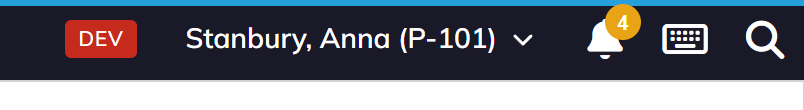
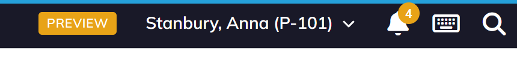
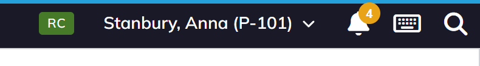

# Web Client

The web client is time cockpit's main client and the one we recommend to new users. It runs without installation in any current browser, on desktop computers and laptops as well as on tablets and smartphones (see [Mobile Guide](~/doc/getting-started/mobile-guide.md)). You can also install it as an app (see [Install time cockpit as an App](#install-time-cockpit-as-an-app)).

## Limitations

- The web client itself does not record signals of your computer. [time cockpit sidekick](~/doc/sidekick/overview.md) does: a small application of its own that records your activities and shows them in the Time Sheet Calendar of the web client; sidekick is currently in preview. Signals that the [classic Signal Tracker](~/doc/signal-tracker/overview.md) of the full client records are shown in the web client, too.
- The data model cannot be changed in the web client. Changes you make with the full client are available in the web client, though (see [Data Model Customization](~/doc/data-model-customization/overview.md)).

If you have questions about sidekick, the Signal Tracker or customizing time cockpit, write to us at [support@timecockpit.com](mailto:support@timecockpit.com).

## Install time cockpit as an App

time cockpit is a Progressive Web App (PWA): you can install the web client like an application. It then runs in a window of its own and can be started from the Start menu or the taskbar.

1. Open [time cockpit](https://web.timecockpit.com) in Google Chrome or Microsoft Edge.
2. Click the install icon on the right of the address bar, then **Install**. The browser calls the app **time cockpit**.

### Several Tabs in the App Window

By default, the installed app opens every page in a window of its own. Chrome and Edge can show tabs in the app window instead. The setting for this is an experimental browser feature; whether it exists and what it is called can change with every browser version.

1. In Chrome, open `chrome://flags/`; in Edge, open `edge://flags/`.
2. Search for the setting **Desktop PWA tab strips** and set it to **Enabled**.
3. Restart the browser when it asks you to.

## Release Plan

You always open time cockpit at <https://web.timecockpit.com>. We decide for your tenant or for individual users which of the four environments you work in there; the address in the browser stays the same. A new version reaches Prod around the 10th of each month, and the other environments get it somewhat earlier.

A badge at the top right of the menu bar of the web client shows the environment. On a narrow screen, it shows only the first three letters, for example **PRE**.

You need the addresses under **Targeted test** only if you want to try a particular environment: they open exactly that environment, regardless of our setting.

| Environment | Description |
|---|---|
| **Dev**  | Experimental version that we update continuously. Do not use Dev for your productive work: some things are likely broken there, and with your production tenant Dev can even damage data. If you want to try Dev, ask for a time cockpit sandbox.  Targeted test: <https://web-dev.timecockpit.com> |
| **Preview**  | Gets a new version before the release candidate. Considerably more stable than Dev but can still change. Use Preview to prepare your team for a new version and to give us feedback.  Targeted test: <https://web-preview.timecockpit.com> |
| **Release candidate (RC)**  | The version that goes to Prod next, ideally one to two weeks before the Prod release. Considerably more users work in the RC than in Preview.  Targeted test: <https://web-rc.timecockpit.com> |
| **Prod**  no badge | The stable production environment. A new version arrives around the 10th of each month, together with our newsletter. During the month, we update Prod only for critical fixes.  Targeted test: <https://web-prod.timecockpit.com> |
