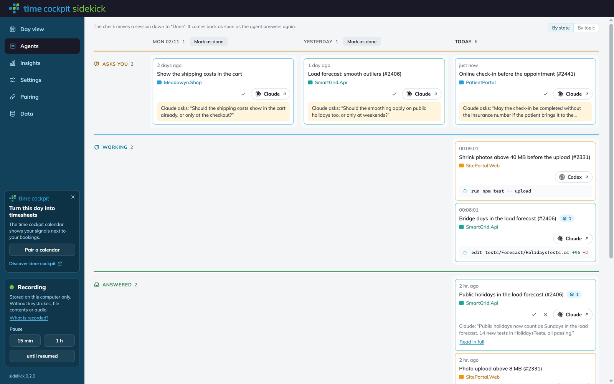
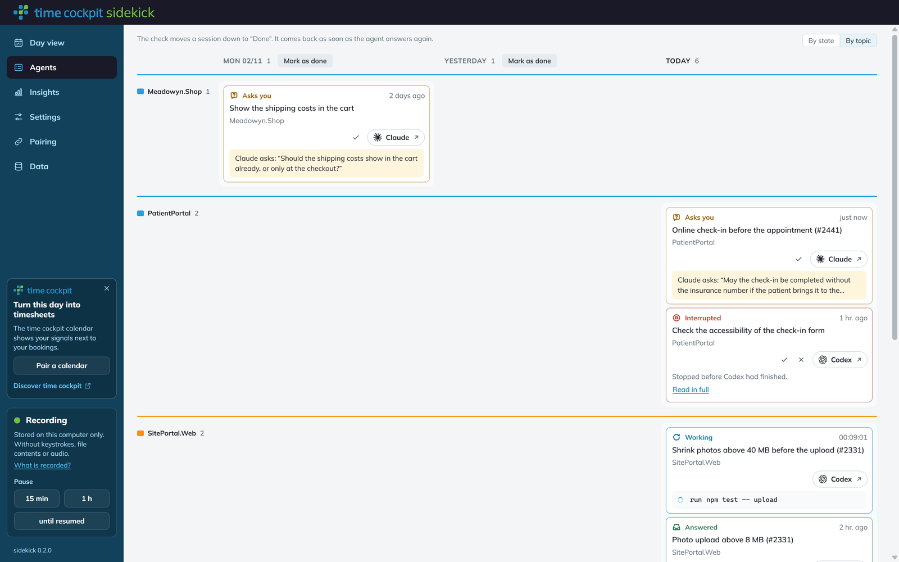

# The Agents Tab of sidekick

> [!WARNING]
> Early preview: time cockpit sidekick is in an early preview. Features, labels and setup steps can change without notice. sidekick runs on Windows 10/11; the macOS version is still being tested. During the preview, sidekick works only with `https://web-preview.timecockpit.com`. Feedback: [support@timecockpit.com](mailto:support@timecockpit.com)

If you work with several Claude Code or Codex sessions at the same time, one of them is often waiting for you: it asks a question, it has finished, or it stopped halfway. The tab **Agents** in sidekick shows the sessions on your computer by whose turn it is, so you see at a glance which one needs you and which ones are still working.

The tab is between **Day view** and **Insights**. It reads the sessions live from the files of Claude Code and Codex and stores nothing of them (see [Privacy](#privacy)).

## Your Turn, Day by Day

The upper part of the tab shows the sessions where it is your turn. Each day with such a session has a column, with today at the right. A day without a session that waits for you has no column. If there are more days than fit side by side, the oldest are gathered in the column **Older** at the left.

The head of a column names the day (**Today**, **Yesterday** or the weekday with the date) and counts its sessions. Each session is a card with its time, its title, its project and its buttons. A question is shown in a yellow box, a running session with its latest tool calls, and a finished one with the start of its answer and **Read in full**.

When nothing waits for you, the area says **All done.**, or, while sessions are still running, **No session needs you right now; the agents are working.**

## States

With **By state**, every state that has a session is a row of its own, with its name, its count and a coloured line across the width:

| State | What it means |
|---|---|
| **Asks you** | The agent asks you a question and waits for your answer. In Claude Code this also covers a plan that waits for your approval and, in the Claude desktop app, a finished turn that ends with a question. A question you set aside shows as **Question open**. |
| **Working** | The agent is working on a turn, in the column of today. The card shows how long the turn has been running and its latest tool calls. A card that says **Waiting** belongs to a turn that has ended, but the agent waits for a task it started in the background and goes on by itself (Claude Code only). |
| **Answered** | The agent has finished and you have not marked its answer as done yet. |
| **Interrupted** | The turn was stopped before the agent had finished, for example because you stopped it or rejected a tool call. |
| **Cut off** | Claude Code was closed in the middle of the turn. Nothing goes on until you open the session and tell the agent to continue. **Unanswered** means that the app was closed before the agent began with your last message; send it again. |
| **Gone quiet** | The turn has no end and there has been no activity for at least five minutes (an hour while a tool call runs). Whether it still runs is unclear. |

The hint of a state word explains it where the word alone does not say enough.

## By State or by Topic

The switch **By state | By topic** at the top right changes what the rows of the upper area are. sidekick remembers your choice.

- **By state**: one row per state, as described above.
- **By topic**: one row per topic, in alphabetical order, each opened by a line in the colour of the topic. The cards then show their state again, with its word and colour.

The topic of a session is the workspace its folder belongs to, or the name of the folder, in the colour the **Day view** draws it in on the day of the session's last activity. The frame of a card and its project are in the same colour.

## Marking Sessions as Done

A session stays in the upper area until you say you are done with it. Opening its details or opening it in Claude or Codex does not change that.

- The check (**Mark as done**) moves a session down to **Done**. It comes back as soon as the agent answers again, also when its next turn is interrupted. The line above the days says this as well.
- On a question, the check is called **Set the question aside**. The session rests as **Question open** until something new happens in it.
- In **Done**, the arrow (**Mark as not done**) brings a session back up to its day.
- The head of every day except today has **Mark all n as done** (for a day with one session, **Mark as done**), which marks all sessions of that day at once. For 15 seconds a line above the days then offers **Undo**. Sessions of today are marked one by one.
- The cross (**Dismiss**) is offered on a session whose turn has ended. It parks the session under **Dismissed**, where it stays until it runs or asks again, or until you choose **Restore**.

Below the days, the area **Done** holds every session that rests, in the groups **Today**, **This week**, **Older** and **Dismissed**. Click **Done** to open or fold it.

### Your First Visit

On your first visit, only sessions whose turn ended in the last 24 hours count as yours. Older endings rest under **Done** from the start, so the board does not open with every session you ever had.

## Details and Opening a Session

Click the title of a card to open its details in a pane at the right:

- the buttons to open the session and to mark it as done,
- what the session is doing now, while something runs (**Now**),
- the **Last result** in full,
- the tasks it runs in the background (**In the background**),
- the **Timeline** with its latest events,
- the model and the folder.

Drag the left edge of the pane to make it wider or narrower. The cross at the top right of the pane or **Esc** closes it.

To continue a session, use the button with the name of the agent on its card (**Claude** or **Codex** with an arrow), **Open in Claude** or **Open in Codex** in the details, or click the yellow box of a question. sidekick hands the session to the Claude desktop app or to Codex, where you answer.

### Background Tasks

For Claude Code, a small mark next to the title shows how many commands or subagents the session started in the background and that have not reported back yet. The details list each with its description, its kind (**Command** or **Subagent**) and when it started. The mark is a hint, not a state: a server left running in the background does not keep a session in **Working**. When a session has been silent for more than 12 hours, its background tasks are shown as **unclear**, because they end without a trace when Claude Code is closed.

## Which Sessions Appear

- Claude Code and Codex sessions on this computer that changed in the last 30 days.
- Not archived sessions, and not the subagent threads of Codex.
- Not the sessions of an agent you switched off in sidekick under **Settings**.

The first time you open the tab after starting sidekick, reading all sessions can take a moment. The newest appear first, and a line above the list says how many sessions are still being read.

If the file of a session cannot be read for a moment, for example because a virus scanner locks it, the card is greyed and shows the last known state.

## Limits

- Only Claude Code and Codex. GitHub Copilot and other agents are not shown.
- Only sessions on this computer. Sessions on [remote machines](overview.md#what-sidekick-records) that sidekick reads over SSH are not on the board.
- A Claude Code session can be opened from sidekick only if the Claude desktop app knows it. A session started in a terminal shows the agent's name without the arrow; continue it in that terminal.
- When Claude Code asks for permission to run a tool, the board cannot tell this from the session files. The session shows as **Working**, as if the tool call were running.
- Background tasks and **Waiting** are shown for Claude Code only.

## Privacy

The tab reads the sessions live while it is on screen. Nothing of it is stored in the sidekick database, shown in the Time Sheet Calendar or sent anywhere. sidekick only remembers on this computer which sessions you marked as done or dismissed, and how you arranged the tab.

The board shows more of a session than the day view does: the agent's last message, its questions and the start of the commands it runs. See [sidekick Privacy and Data](privacy-and-data.md#the-agents-tab).

## Related Pages

- [time cockpit sidekick](overview.md)
- [sidekick Signals in the Time Sheet Calendar](calendar-signals.md)
- [sidekick Privacy and Data](privacy-and-data.md)
