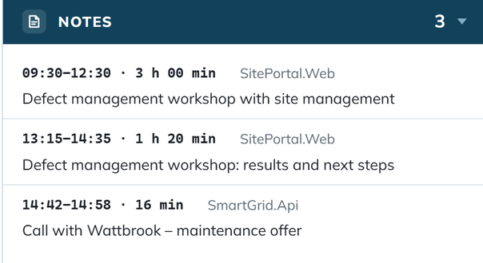

# Quick Notes with sidekick

> [!WARNING]
> Early preview: time cockpit sidekick is in an early preview. Features, labels and setup steps can change without notice. sidekick runs on Windows 10/11; the macOS version is still being tested. During the preview, sidekick works only with `https://web-preview.timecockpit.com`. Feedback: [support@timecockpit.com](mailto:support@timecockpit.com)

Signals show when you worked and with which applications, but not always what the work was. A phone call, a conversation at the desk or a quick fix leaves few traces. With a quick note you write it down in a few words, without leaving the application you are in. sidekick keeps the note with its time, and the [Time Sheet Calendar](~/doc/timesheet-calendar/calendar.md) shows it next to the signals, so you can book it later with its text.

A note can do two things:

- **Like a timer**: write a note when you start, for example "Workshop preparation". It runs until you end it or write the next note.
- **Afterwards**: write a note when you are done, for example after a call, and set its begin, for example 30 minutes back.

## Open the Note Window

- Press the key combination for a new note: **Ctrl+Alt+N** on Windows, **⌘⌥N** on macOS. You can change or switch off the combination in the settings (see [Key Combination](#key-combination)).
- Or choose **Note…** in the menu of the tray icon.

The window **Note** opens over any application, on the screen with the mouse pointer, and the cursor is in the text field. Type what you are working on and press **Enter**.

## The Note Window

| Field | What it does |
|---|---|
| Text field | What you are working on, in a few words. **Shift+Enter** starts a new line. |
| **Time** | When the note starts or ends. It starts with the current time (hint **now**) and can be changed. |
| **No duration** | The note stays a point in time: it does not run, cannot be ended and becomes no proposal in the calendar. The tick hides the begin. |
| **Begin** | Optional. With a begin, the note covers the time from the begin to **Time**; see below. |
| **Workspace** | Which of today's workspaces or meetings the note belongs to. |

Above the buttons, one sentence says what **Enter** will do with what the fields say now, for example "Starts at 11:00 and runs until you end it or write the next note." or "Covers 10:30 to 11:00 (30 min) and does not run on."

**Enter** or **Save** saves the note, and sidekick confirms it with a silent notification **Note saved**. **Esc** discards the note. If you close the window with its close button or click into another window, the text is kept for the next time you open it. A window left open moves behind the other windows and has its own button on the task bar; the key combination brings it back to the front.

### A Note That Runs

Without a begin, the note starts at **Time** and runs, like a timer, until you end it or write the next note. The newest note of today that can still be ended is the running note.

While a note runs, the note window shows it at the top, for example "Running since 16:45 · 1 h 16 min" with its text:

- **To end it**, open the note window, leave the text empty and press **Enter**. The button says **End at 18:01**; sidekick confirms with **Note ended**. **Esc** closes the window and the note keeps running.
- **To switch to something else**, type the new note. **End the running note at 18:01** is ticked: saving ends the running note at **Time**, and the new note starts there and runs. Clear the tick to keep the running note open; the begin is then available again.

Older notes that are still open are ended in the day view of sidekick (see [Edit, End and Delete Notes](#edit-end-and-delete-notes)).

### A Note with a Begin

With a begin, the note covers the time from the begin to **Time** and does not run on. The chips next to the begin set it with one click:

- "since 10:12 · back at the desk": the end of your last break of at least 15 minutes today, with its time.
- **−15 min**, **−30 min** and **−1 h**: that long before **Time**.

For example, when you hang up after a call, open the note window, type "Call with the customer about the offer" and choose **−30 min**.

### Workspace

**Workspace** shows today's workspaces and meetings as chips, in the same colours as in the day view of sidekick. The one that was in front during the last quarter hour is preselected. Choose another chip, or **None** for a note without a workspace. The calendar draws the note in the colour of its workspace.

## Edit, End and Delete Notes

Notes are edited, ended and deleted only in sidekick. Open the tab **Day view**:

- On a day with notes, the track **Notes** right of **Active** shows a sheet symbol for each note at its time, in the colour of its workspace. A note with an end has a thin bar down to its end. The tooltip shows the text.
- The right pane starts with the section **Notes**: the notes of the day, or of the selected range. The search of the pane finds notes as well.
- The row of the running note says, for example, "running for 1 h 15 min" and has the button **End at 18:01**, which ends the note now. The arrow next to it opens **End at** for another time of the note's day and **Leave without a duration**. Every other open note has **End** among the buttons of its row.
- **Edit** opens a small form in the row with the text, **Begin**, **End (optional)**, **No duration** and **Workspace**. **Ctrl+Enter** or **Save** saves the changes, **Esc** or **Cancel** discards them.
- **Delete** asks **Delete this note?** in the row. Confirm with **Delete**, or keep the note with **Cancel**.

## Key Combination

In sidekick, open **Settings** and, in the group **For all machines**, the area **Notes**.

- Click into the field **Key combination for a new note** and press the keys you want. A combination needs **Ctrl** (**⌘** on macOS), **Alt** or **Win** and exactly one other key.
- **Off** switches the key combination off. **Default** restores **Ctrl+Alt+N** (**⌘⌥N** on macOS).
- The change takes effect when you save the settings.

While sidekick runs, no other application gets this key combination. If another application already uses it, the area says so; choose another combination. **Note…** in the menu of the tray icon keeps working either way.

## Notes in the Time Sheet Calendar

The calendar reads your notes from sidekick together with the signals:

- Every view shows each note at its time, in the colour of its workspace. A running note grows up to the current time.
- A double-click on a note, or **Book** in its tooltip, opens a new booking with the text and the time of the note. See [Quick Notes](calendar-signals.md#quick-notes).
- In the day view, the lane **Proposal** shows every note with a duration as a block of its own, the running note up to now. In its time range, the note takes precedence over the other signals. Notes without a duration make no proposal.

The calendar never changes or deletes a note.

## Privacy and Deletion

Notes stay on your computer, in the same database as the signals, and are included in the daily backups. sidekick never uploads them, and the calendar reads them in the same way as the signals: only from the browser on the same computer, and only for paired calendars.

Unlike signals, notes are not deleted after the retention period; they stay until you delete them. **Delete data** in the tab **Data** keeps your notes unless you select **Delete notes as well**. See [sidekick Privacy and Data](privacy-and-data.md#deleting-data).

## Related Pages

- [time cockpit sidekick](overview.md)
- [sidekick Signals in the Time Sheet Calendar](calendar-signals.md)
- [sidekick Privacy and Data](privacy-and-data.md)
